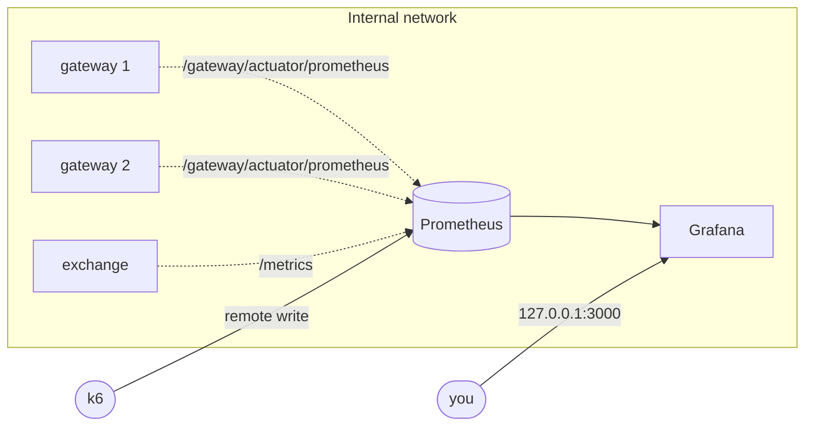
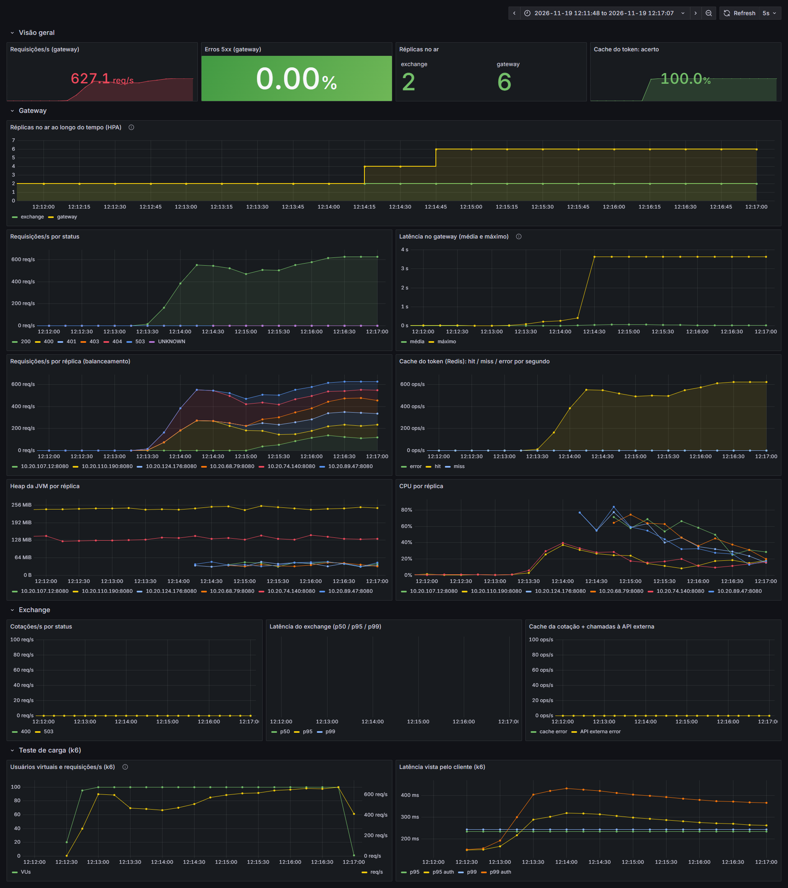

# Observability

!!! info "Owner: Gabriel"

## Problem { #problema }

With several gateway replicas behind Nginx, a cache in Redis and a service that depends on an external
API, **there was no way to know what was happening under load**: which replica gets more
requests, whether the cache is hitting, whether errors come from the gateway or from Exchange, whether the JVM is close
to its memory limit. Without that, the [load test](../devops/load-testing.md) would only show the client's final
number, without explaining why.

## Solution { #solucao }

**Prometheus** scrapes each replica's metrics every 5 s and **Grafana** shows a dashboard
versioned in the repository, provisioned automatically (no clicking through the UI).



| Decision | Reason |
|---|---|
| `dns_sd_configs` in compose | The name `gateway` resolves to **all** replica IPs; each one becomes a target (`instance`). With `static_configs` each scrape would land on a random replica and the series would get mixed up. `--scale gateway=N` is picked up on its own within 10 s. |
| `kubernetes_sd_configs` + `prometheus.io/*` annotations on EKS | Prometheus discovers the namespace's pods; anything that wants to be scraped just annotates the pod (gateway and exchange already do). RBAC with a read-only `Role` in the namespace, not a `ClusterRole`. |
| Metrics off the internet | `lb` answers `404` for `/gateway/actuator/**` and the gateway only forwards `/exchange/**` (exchange's `/metrics` is left out). Prometheus and Grafana: `127.0.0.1` in compose and `ClusterIP` + `port-forward` on EKS. |
| Dashboard as JSON in git (`setup/grafana/dashboards/store.json`) | The same file serves compose (volume) and EKS (ConfigMap created by the `infra` workflow). Dashboard changed → PR. |
| k6 remote write | The load test shows up on the same dashboard, on the same time axis as the server metrics. |
| Grafana password out of git | Compose: `GRAFANA_ADMIN_PASSWORD` in `.env`. EKS: Secret created by the workflow (org secret or random). |
| Exchange with a histogram; gateway with mean/max | Exchange publishes buckets (`exchange_http_server_requests_seconds_bucket`), so it has p50/p95/p99. Spring Boot does not publish buckets by default; the client-side percentiles come from k6. |

## Metrics used { #metricas-usadas }

| Source | Metric | What for |
|---|---|---|
| gateway (Micrometer) | `http_server_requests_seconds_{count,sum,max}` | req/s by status and by replica, mean/max latency, 5xx rate |
| gateway | `gateway_token_cache_total{result}` | [token cache](cache.md) hit rate |
| gateway | `jvm_memory_used_bytes`, `process_cpu_usage` | memory and CPU per replica |
| exchange | `exchange_http_server_requests_seconds` (histogram, label `route` = template) | quote req/s and p50/p95/p99 |
| exchange | `exchange_quote_cache_total{result}` | [quote cache](exchange-cache.md) hit rate |
| exchange | `exchange_upstream_request_seconds{outcome}` | calls to and latency of the external API |
| Prometheus | `up{job}` | replicas up (the HPA number and curve) |
| k6 | `k6_vus`, `k6_http_reqs_total`, `k6_http_req_duration_p95/p99` | applied load and latency seen by the client |

Exchange's `route` label uses the route **template** (`/exchange/{from_}/{to}`), not the actual URL: otherwise
each currency pair would create a new series in Prometheus (cardinality explosion). There is a test for this.

## Dashboard { #dashboard }

**Store — plataforma** (*Store* folder, also Grafana's home page):

| Row | Panels |
|---|---|
| Overview | req/s, % of 5xx (green/orange/red), replicas up per service, token cache hit % |
| Gateway | **replicas up over time** (shows the HPA), req/s by status, mean/max latency, **req/s per replica** (shows the balancing), cache hit/miss/error, heap and CPU per replica |
| Exchange | quotes/s by status, p50/p95/p99, quote cache × calls to the external API |
| Load test (k6) | VUs and req/s, client p95/p99 per scenario |

## How to use { #como-usar }

=== "Compose"

    ``` bash
    docker compose up -d --build
    # Grafana:    http://localhost:3000   (admin / GRAFANA_ADMIN_PASSWORD do .env)
    # Prometheus: http://localhost:9090/targets   (uma linha por réplica)
    ```

=== "EKS"

    ``` bash
    kubectl port-forward svc/grafana 3000 -n store
    kubectl get secret grafana-admin -n store -o jsonpath='{.data.password}' | base64 -d
    kubectl port-forward svc/prometheus 9090 -n store
    ```

To see the dashboard move, run a [load test](../devops/load-testing.md) in another terminal.

## Result: what observability showed { #resultado-o-que-a-observabilidade-mostrou }

Verified on 05/11/2026 with the local platform up: Prometheus discovered the 2 gateway replicas
and exchange on its own (`/targets`, all `up`), Grafana came up with the data source and the dashboard already
provisioned, and every dashboard query returns data.

During the [load test](../devops/load-testing.md) it was observability that **explained** the numbers
k6 only showed from the outside:

| Question | Where the answer showed up |
|---|---|
| Is the token cache really sparing Auth? | `gateway_token_cache_total`: **7,571 hits × 21 misses** in the run with cache (99.7 %). |
| Why did 4 replicas deliver *less* than 1 at saturation? | Machine CPU (`system_cpu_usage`) at ≈ 83–85 % in both runs: the replicas were competing for the same cores. |
| Where did the 0.57 % errors at saturation come from? | `http_server_requests_seconds_count{status="500"}` on the gateway (≈ 3,500) → Auth logs: `BindException` when calling Account (Feign without a connection pool). |
| Do the replicas the HPA created get load right away? | **No:** in the [HPA test](../devops/load-testing.md#ensaio-local-kind), "Requisições/s por réplica" showed the 4 new ones starting at 0 req/s and the load split evenly only ≈ 1.5 min after they became ready. `lb` reuses connections and the Kubernetes Service balances connections, not requests ([finding](../devops/load-testing.md#achado-balanceamento)). Fixed in `lb` with `keepalive_time 10s` (≈ 35–40 s in the trial run). |

### During the HPA test { #durante-o-teste-com-hpa }

Grafana on **EKS** during the HPA test of 19/11 ([result](../devops/load-testing.md#resultado-no-eks)),
from the start of the load to the end of k6: the gateway scales from 2 to 4 and then 6 replicas, with 0 % 5xx
errors and the token cache hitting 100 %. The *exchange* row has no traffic because the `auth` scenario does
not call the exchange service.



The same test, rehearsed earlier on a kind cluster ([local trial run](../devops/load-testing.md#ensaio-local-kind)),
showed the same pattern: 2 → 6 replicas in ≈ 1 min, 0 % errors.

For this test the dashboard gained the **Réplicas no ar ao longo do tempo (HPA)** panel
(`sum by (job) (up{job=~"gateway|exchange"})`, as steps), and the "Erros 5xx" panel now shows
**0 %** instead of *No data* when there are no errors (`... or vector(0)` in the numerator).

!!! tip "Suggestion for the gateway (Leonardo)"

    Turning on `spring.cloud.gateway.server.webflux.metrics.enabled=true` in the gateway would publish
    `spring_cloud_gateway_requests_seconds` with the `routeId`, which would allow breaking latency down by
    route (auth × account × exchange). Also, `management.metrics.distribution.percentiles-histogram.http.server.requests=true`
    would give server-side p95/p99.

## Configuration { #configuracao }

=== "setup/prometheus.yml"

    ``` { .yaml .copy }
    --8<-- "setup/prometheus.yml"
    ```

=== "k8s/prometheus.yaml"

    ``` { .yaml .copy }
    --8<-- "k8s/prometheus.yaml"
    ```

=== "k8s/grafana.yaml"

    ``` { .yaml .copy }
    --8<-- "k8s/grafana.yaml"
    ```
