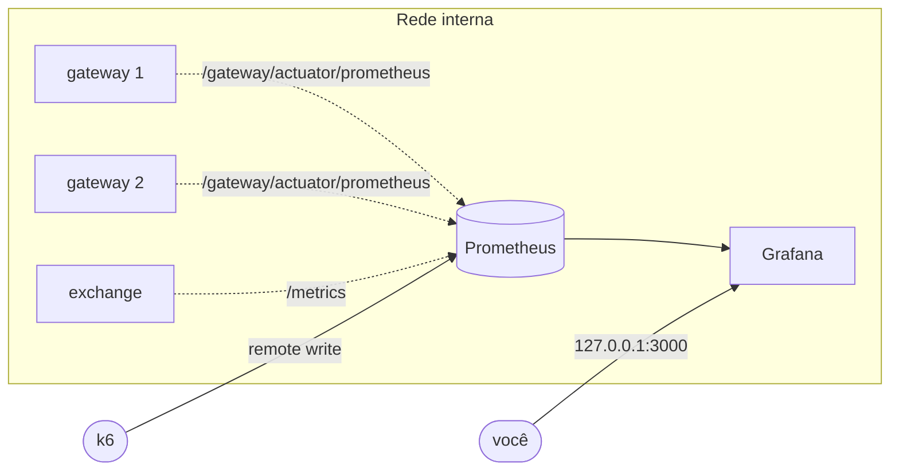
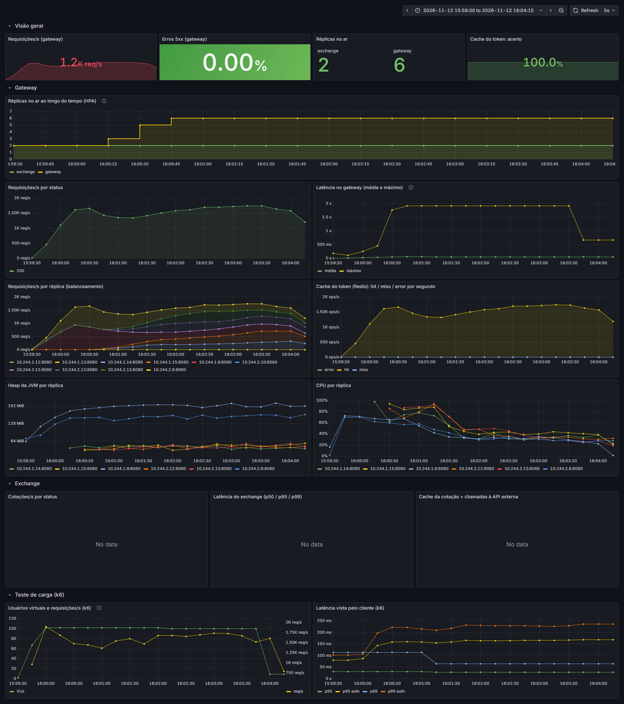

# Observabilidade

!!! info "Responsável: Gabriel"

## Problema

Com várias réplicas do gateway atrás do Nginx, um cache no Redis e um serviço que depende de uma API
externa, **não dava para saber o que estava acontecendo sob carga**: qual réplica recebe mais
requisições, se o cache está acertando, se os erros vêm do gateway ou do Exchange, se a JVM está perto
do limite de memória. Sem isso, o [teste de carga](../devops/load-testing.md) só mostraria o número
final do cliente, sem explicar o porquê.

## Solução

**Prometheus** raspa as métricas de cada réplica a cada 5 s e o **Grafana** mostra um dashboard
versionado no repositório, provisionado automaticamente (sem clicar na interface).



| Decisão | Motivo |
|---|---|
| `dns_sd_configs` no compose | O nome `gateway` resolve para **todos** os IPs das réplicas; cada uma vira um alvo (`instance`). Com `static_configs` cada scrape cairia numa réplica aleatória e as séries se misturariam. `--scale gateway=N` entra sozinho em até 10 s. |
| `kubernetes_sd_configs` + anotações `prometheus.io/*` no EKS | O Prometheus descobre os pods do namespace; quem quer ser raspado só anota o pod (gateway e exchange já anotam). RBAC com `Role` só de leitura no namespace, não `ClusterRole`. |
| Métricas fora da internet | O `lb` responde `404` para `/gateway/actuator/**` e o gateway só encaminha `/exchange/**` (o `/metrics` do exchange fica de fora). Prometheus e Grafana: `127.0.0.1` no compose e `ClusterIP` + `port-forward` no EKS. |
| Dashboard em JSON no git (`setup/grafana/dashboards/store.json`) | O mesmo arquivo serve o compose (volume) e o EKS (ConfigMap criado pelo workflow `infra`). Mudou o dashboard → PR. |
| Remote write do k6 | O teste de carga aparece no mesmo dashboard, no mesmo eixo de tempo das métricas do servidor. |
| Senha do Grafana fora do git | Compose: `GRAFANA_ADMIN_PASSWORD` no `.env`. EKS: Secret criado pelo workflow (secret da org ou aleatória). |
| Exchange com histograma; gateway com média/máximo | O exchange publica buckets (`exchange_http_server_requests_seconds_bucket`), então tem p50/p95/p99. O Spring Boot não publica buckets por padrão; os percentis do lado do cliente vêm do k6. |

## Métricas usadas

| Origem | Métrica | Para quê |
|---|---|---|
| gateway (Micrometer) | `http_server_requests_seconds_{count,sum,max}` | req/s por status e por réplica, latência média/máxima, taxa de 5xx |
| gateway | `gateway_token_cache_total{result}` | acerto do [cache do token](cache.md) |
| gateway | `jvm_memory_used_bytes`, `process_cpu_usage` | memória e CPU por réplica |
| exchange | `exchange_http_server_requests_seconds` (histograma, label `route` = template) | req/s e p50/p95/p99 da cotação |
| exchange | `exchange_quote_cache_total{result}` | acerto do [cache da cotação](exchange-cache.md) |
| exchange | `exchange_upstream_request_seconds{outcome}` | chamadas e latência da API externa |
| Prometheus | `up{job}` | réplicas no ar (o número e a curva do HPA) |
| k6 | `k6_vus`, `k6_http_reqs_total`, `k6_http_req_duration_p95/p99` | carga aplicada e latência vista pelo cliente |

O label `route` do exchange usa o **template** da rota (`/exchange/{from_}/{to}`), não a URL real: senão
cada par de moedas criaria uma série nova no Prometheus (explosão de cardinalidade). Há um teste para isso.

## Dashboard

**Store — plataforma** (pasta *Store*, também é a página inicial do Grafana):

| Linha | Painéis |
|---|---|
| Visão geral | req/s, % de 5xx (verde/laranja/vermelho), réplicas no ar por serviço, % de acerto do cache do token |
| Gateway | **réplicas no ar ao longo do tempo** (mostra o HPA), req/s por status, latência média/máxima, **req/s por réplica** (mostra o balanceamento), cache hit/miss/error, heap e CPU por réplica |
| Exchange | cotações/s por status, p50/p95/p99, cache da cotação × chamadas à API externa |
| Teste de carga (k6) | VUs e req/s, p95/p99 do cliente por cenário |

## Como usar

=== "Compose"

    ``` bash
    docker compose up -d --build
    # Grafana:    http://localhost:3000   (admin / GRAFANA_ADMIN_PASSWORD do .env)
    # Prometheus: http://localhost:9090/targets   (uma linha por réplica)
    ```

=== "EKS"

    ``` bash
    kubectl port-forward svc/grafana 3000 -n store
    kubectl get secret grafana-admin -n store -o jsonpath='{.data.password}' | base64 -d
    kubectl port-forward svc/prometheus 9090 -n store
    ```

Para ver o dashboard se mexer, rode um [teste de carga](../devops/load-testing.md) em outro terminal.

## Resultado: o que a observabilidade mostrou

Verificado em 05/11/2026 com a plataforma local no ar: o Prometheus descobriu sozinho as 2 réplicas
do gateway e o exchange (`/targets`, todos `up`), o Grafana subiu com o data source e o dashboard já
provisionados, e todas as consultas do dashboard retornam dados.

Durante o [teste de carga](../devops/load-testing.md) foi a observabilidade que **explicou** os números
que o k6 só mostrava de fora:

| Pergunta | Onde a resposta apareceu |
|---|---|
| O cache do token está mesmo poupando o Auth? | `gateway_token_cache_total`: **7.571 hits × 21 misses** na rodada com cache (99,7 %). |
| Por que 4 réplicas renderam *menos* que 1 na saturação? | CPU da máquina (`system_cpu_usage`) em ≈ 83–85 % nas duas rodadas: as réplicas disputavam os mesmos núcleos. |
| De onde vieram os 0,57 % de erro na saturação? | `http_server_requests_seconds_count{status="500"}` no gateway (≈ 3.500) → logs do Auth: `BindException` ao chamar o Account (Feign sem pool de conexões). |
| As réplicas que o HPA criou recebem carga logo? | **Não:** no [teste com HPA](../devops/load-testing.md#ensaio-local-kind), "Requisições/s por réplica" mostrou as 4 novas começando com 0 req/s e a carga dividida por igual só ≈ 1,5 min depois de elas ficarem prontas. O `lb` reaproveita conexões e o Service do Kubernetes balanceia conexões, não requisições ([achado](../devops/load-testing.md#achado-balanceamento)). |

### Durante o teste com HPA

Ensaio local do teste com HPA ([roteiro e resultado](../devops/load-testing.md#ensaio-local-kind)),
do início do k6 ao fim da carga: o gateway sobe de 2 para 6 réplicas em ≈ 1 min, com 0 % de erros 5xx
e o cache do token acertando 100 %. A linha *exchange* fica vazia porque o cenário `auth` não chama o
câmbio.



Para esse teste o dashboard ganhou o painel **Réplicas no ar ao longo do tempo (HPA)**
(`sum by (job) (up{job=~"gateway|exchange"})`, em degraus), e o painel "Erros 5xx" passou a mostrar
**0 %** em vez de *No data* quando não há nenhum erro (`... or vector(0)` no numerador).

!!! tip "Sugestão para o gateway (Leonardo)"

    Ligar `spring.cloud.gateway.server.webflux.metrics.enabled=true` no gateway publicaria
    `spring_cloud_gateway_requests_seconds` com o `routeId`, o que permitiria quebrar a latência por
    rota (auth × account × exchange). Também `management.metrics.distribution.percentiles-histogram.http.server.requests=true`
    daria p95/p99 do lado do servidor.

## Configuração

=== "setup/prometheus.yml"

    ``` { .yaml .copy }
    --8<-- "setup/prometheus.yml"
    ```

=== "k8s/prometheus.yaml"

    ``` { .yaml .copy }
    --8<-- "k8s/prometheus.yaml"
    ```

=== "k8s/grafana.yaml"

    ``` { .yaml .copy }
    --8<-- "k8s/grafana.yaml"
    ```
