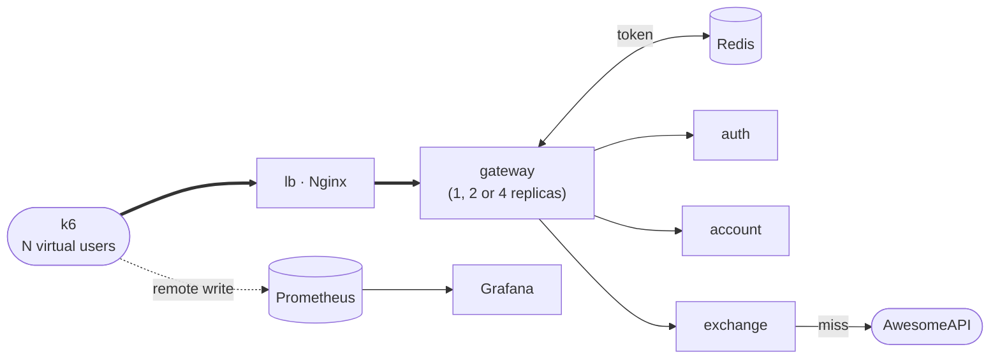
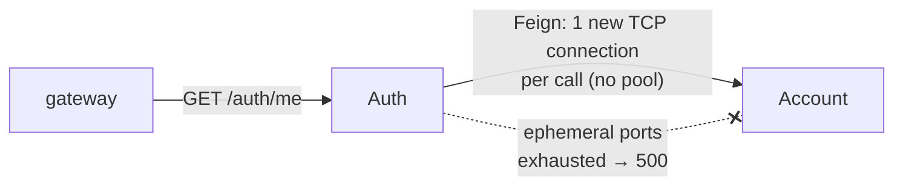
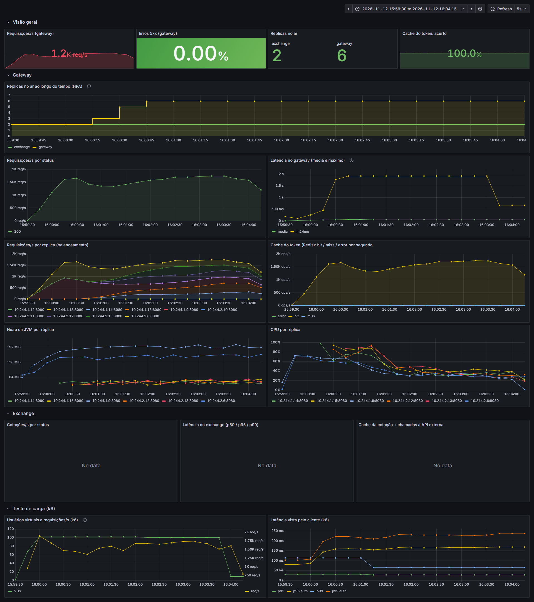
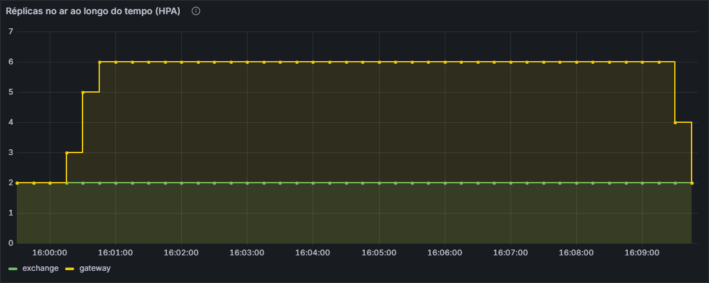
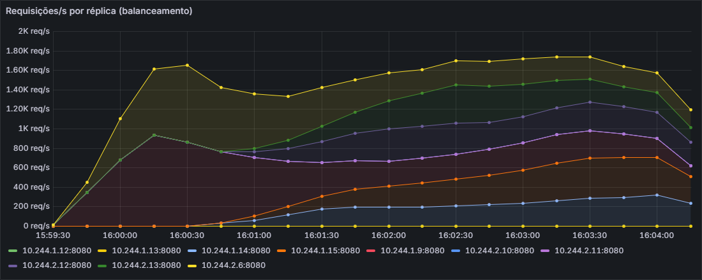
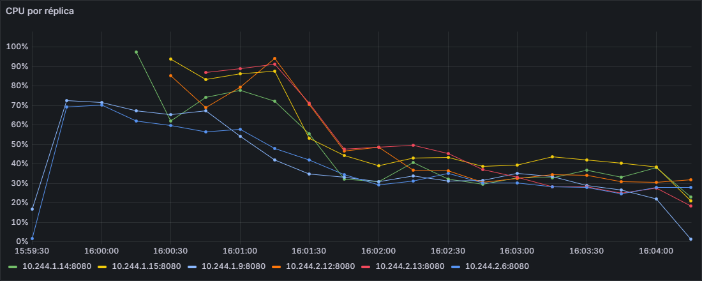
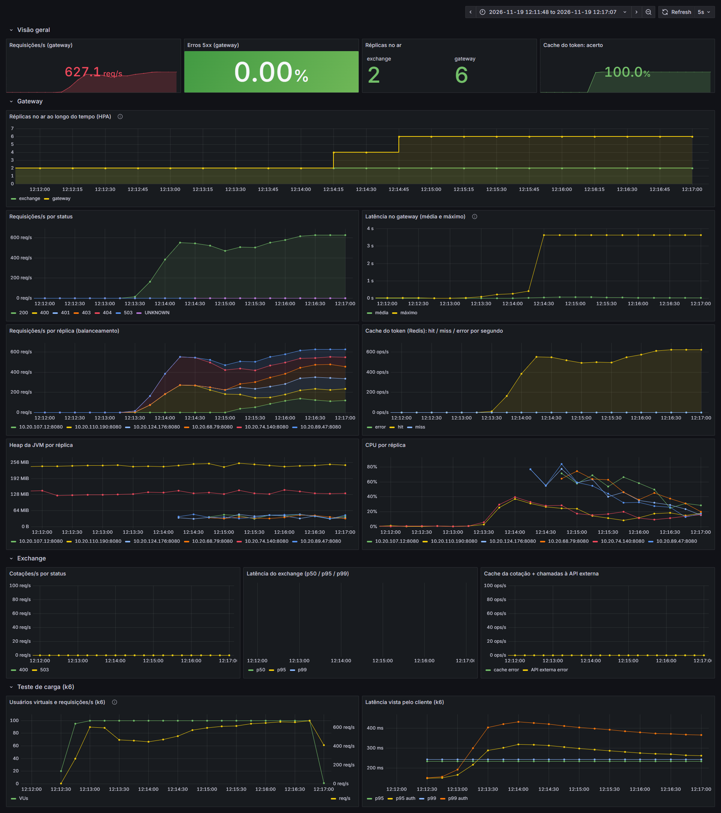

# Load testing

!!! info "Owner: Gabriel"

Tool: **[k6](https://k6.io){target="_blank"}** (Grafana Labs), running in a container — nobody in the
group needs to install anything besides Docker. We chose k6 over JMeter/Locust because the test is
a JavaScript file versioned in the repository, the acceptance limits (*thresholds*) live in the
script itself, and it sends metrics straight to Prometheus, so the load shows up in the same
[Grafana dashboard](../bottlenecks/observability.md) as the server metrics.

## What is tested { #o-que-e-testado }



The script's `setup()` creates 20 accounts and logs in once; after that the virtual users (VUs) reuse
the tokens, like real users browsing while logged in. Each VU waits 0.5–1.5 s between actions.

| Scenario | Requests | What it exercises |
|---|---|---|
| `auth` | `GET /auth/me` + `GET /accounts/{id}` | token validation (Redis or Auth), load balancing, Account + PostgreSQL |
| `exchange` | `GET /exchange/USD/BRL` (80 %) and `EUR/BRL` | gateway → Exchange → quote cache / external API |
| `login` | `POST /auth/login` | expensive path: password hash + JWT issuance |
| `mixed` | 80 % authenticated reads, 15 % exchange, 5 % login | "real" store usage |

| Profile | Load shape | Question it answers |
|---|---|---|
| `smoke` | 1 VU, 20 s | Do the script and the platform work? |
| `load` | ramps up to `VUS` in 20 s, holds for `DURATION`, ramps down | Does it handle the expected load within the SLO? |
| `stress` | `VUS` → ×2 → ×4 → ×8, 30 s each | Where does it break? Which component saturates first? |
| `spike` | `VUS/10` → spike to `VUS×4` in 5 s → back | Does it handle a sudden spike and recover? |

**Acceptance criteria** (the same as the [SLO](custos-sla.md#sla-e-slo)), checked by k6 — it exits
with code `99` if any of them is exceeded:

| Metric | Limit |
|---|---|
| Errors (`http_req_failed`) | < 1 % |
| p95 / p99 latency (expected responses) | < 500 ms / < 1500 ms |
| `checks` (response status and content) | > 99 % |

## How to run { #como-rodar }

``` bash
./scripts/build.sh && docker compose up -d --build     # plataforma + Prometheus + Grafana

./scripts/load-test.sh                                  # mixed, perfil load, 50 VUs, 1 min
SCENARIO=auth PROFILE=stress VUS=50 ./scripts/load-test.sh
SCENARIO=exchange PROFILE=spike VUS=20 ./scripts/load-test.sh
THINK=0 SCENARIO=auth PROFILE=stress VUS=25 ./scripts/load-test.sh   # sem pausa: limite de vazão
BASE_URL=http://<endereço-do-elb> ./scripts/load-test.sh   # contra o EKS

./scripts/load-matrix.sh        # todos os experimentos abaixo (~25 min) -> load/results/RESULTS.md
```

While it runs, open Grafana at [http://localhost:3000](http://localhost:3000){target="_blank"}: the
**Teste de carga (k6)** row shows VUs, req/s and client-side p95/p99, and the rows above show what
happens in each replica, in Redis and in Exchange at the same moment.

## Experiments { #experimentos }

`scripts/load-matrix.sh` changes **one** variable at a time and keeps everything else the same (Redis
cache flushed before each run):

| # | Experiment | Variable | Scenario / profile | Hypothesis |
|---|---|---|---|---|
| 1 | Token cache | `TOKEN_CACHE_ENABLED` = `false` × `true` | `auth` / `load` | Without cache, every request calls Auth: more load on Auth and higher latency when it saturates. With cache, `gateway_token_cache_total{result="miss"}` stays close to 20 (one per user). |
| 2 | Gateway replicas | `GATEWAY_REPLICAS` = 1 × 2 × 4 | `auth` / `stress` | More replicas delay the point where p95 blows up — **until** the bottleneck moves to another component (Account/PostgreSQL or the machine's own CPU). |
| 3 | Quote cache | `EXCHANGE_CACHE_TTL` = `0` × `30` | `exchange` / `load`, 10 VUs, 30 s | Without cache, Exchange latency is the external API's and `429`s show up; with cache, ~1 external call every 30 s per replica. Few VUs on purpose: we don't want to hammer a third-party service. |
| 4 | Real usage | default configuration | `mixed` / `load` | Within the SLO. |
| 5 | Saturation | `GATEWAY_REPLICAS` = 1 × 4, **`THINK=0`** (no pause) | `auth` / `stress` up to 200 VUs | With pauses, experiment 2 never reaches the limit; without pauses, each VU fires as fast as possible and shows what breaks first. |

## Results { #resultados }

Measured on **05/11/2026** with `./scripts/load-matrix.sh` (experiments 3 and 5 were run again
with `ONLY="3 5"`). Machine: Windows 11 + Docker Desktop (WSL2), 12 logical CPUs, 7.3 GiB of RAM for
Docker. **k6, Nginx, gateway, services, database, Prometheus and Grafana on the same machine.** Latencies
only for expected responses and only for the test phase (the sign-up/login in `setup()` is excluded).

| Run | Scenario | Profile | Max VUs | Requests | req/s | p50 (ms) | p95 (ms) | p99 (ms) | Errors |
|---|---|---|---:|---:|---:|---:|---:|---:|---:|
| token-cache-off | auth | load | 50 | 7,416 | 80.8 | 5 | 12 | 20 | 0.00 % |
| token-cache-on | auth | load | 50 | 7,448 | 79.7 | 4 | **7** | 15 | 0.00 % |
| replicas-1 | auth | stress | 400 | 41,110 | 290.9 | 2 | 3 | 4 | 0.00 % |
| replicas-2 | auth | stress | 400 | 40,810 | 287.1 | 2 | 17 | 114 | 0.00 % |
| replicas-4 | auth | stress | 400 | 40,918 | 285.8 | 3 | 7 | 23 | 0.00 % |
| exchange-cache-off | exchange | load | 10 | 445 | 7.3 | 23 | 49 | 69 | 0.00 % |
| exchange-cache-on | exchange | load | 10 | 454 | 7.5 | 3 | **4** | 17 | 0.00 % |
| mixed-load | mixed | load | 50 | 6,605 | 72.1 | 4 | 62 | 197 | 0.00 % |
| saturation-1 | auth | stress, `THINK=0` | 200 | 578,564 | **4,120** | 13 | 43 | 69 | **0.57 %** |
| saturation-4 | auth | stress, `THINK=0` | 200 | 387,296 | 2,697 | 14 | 88 | 166 | **0.00 %** |

**All scenarios with pauses (1–4) stayed within the SLO** (errors < 1 %, p95 < 500 ms, p99 < 1.5 s).

### What the numbers show { #o-que-os-numeros-mostram }

**1. Token cache (Redis) — Auth leaves the path.** With the cache on, Prometheus recorded
**7,571 hits and 21 misses** in `gateway_token_cache_total` during the run: 99.7 % of validations did not
call Auth (the 21 misses are ≈ 1 per test user). Without cache, all ≈ 7,400 requests
went through `POST /auth/solve`. Latency dropped from p95 12 → **7 ms** (−42 %). Throughput is the same in
both runs because the pace is set by the users' pauses, not by the server.

**2. Quote cache — the external API leaves the path.** Without cache, every quote went to AwesomeAPI:
p50 of 23 ms and p95 of 49 ms, the latency of a third-party service. With the 30 s cache, p50 of **3 ms** and
p95 of **4 ms** (−92 %). At 10 users the external API held up without `429`, but the volume of calls to it
drops from ≈ 7 per second to 1 every 30 s per replica — that is what protects against the rate limit.

**3. Replicas under "realistic" load — one gateway is plenty.** With the pause between actions, 400 users generate
≈ 290 req/s, and a single replica answers with p95 of 3 ms. The differences between 1, 2 and 4 replicas
(3 / 17 / 7 ms) are noise from freshly started JVMs (JIT not yet warmed up), neither gain nor loss.
Honest conclusion: **at this load the gateway is not the bottleneck**; the reason to have 2+ replicas is
availability (one can go down), not capacity.

**4. Saturation — we found the real bottleneck, and it was not the gateway.** Without pauses, the platform exceeded
**4,100 req/s** with one gateway replica, but **0.57 % of requests failed (3,279)**, all on
`GET /auth/me`, none on `GET /accounts/{id}`. The gateway returned `500` and the Auth log showed
exactly **3,279 × `java.net.BindException: Cannot assign requested address`**:



Auth's `GET /auth/me` calls Account via **OpenFeign with the default HTTP client, without a connection
pool**: each request opens a new TCP connection, and at 4,000 req/s the local ports of the Auth container
run out (closed ones stay in `TIME_WAIT`). With 4 gateway replicas the machine was busier
(CPU at ≈ 83 % in both runs, 4 JVMs competing for the same cores), throughput dropped to
2,697 req/s and Auth did not reach the limit — hence 0 errors, but twice the p95.

!!! tip "Suggested fix (Auth — Nicolas)"

    Replace the Feign client with one that has a **connection pool** and keep-alive — add
    `io.github.openfeign:feign-hc5` to `auth-service` and `spring.cloud.openfeign.httpclient.hc5.enabled=true`.
    With reused connections, Auth stops opening one port per request. Then rerun
    `ONLY=5 ./scripts/load-matrix.sh` to confirm the `500`s are gone.

**5. Real usage (`mixed`).** Within the SLO, but with the longest tail of the batch (p95 62 ms, p99 197 ms):
5 % of the actions are `POST /auth/login`, which hashes the password (expensive on purpose) and issues the JWT.

### Limitations { #limitacoes }

- **Everything on the same machine:** k6 competes for CPU with the platform. The numbers show **trends and
  bottlenecks**, not the EKS capacity. On separate nodes, more replicas should *increase* throughput —
  here they were stuck on the same CPU.
- **Short runs (1–3 min) and one execution per configuration:** differences of a few ms are noise.
- **20 reused accounts:** favors the token cache (it is the logged-in usage pattern, but a test with
  thousands of new users would have more misses).

To measure real capacity: `BASE_URL=http://<elb> ./scripts/load-test.sh` from another machine.

## EKS test with HPA { #teste-no-eks-com-hpa }

The course asks for a **video of the load test running with the HPA scaling**. Plan for the EKS run:
k6 running from a member's machine against the ELB, and the **Horizontal Pod Autoscaler** creating gateway
replicas when average CPU exceeds 50 % of the `request` (250m → 125m per pod).

!!! warning "Before you start"

    - **kubectl 1.36 or newer** (`kubectl version --client`): the cluster is 1.37 and kubectl is only
      supported within one version of skew. The `--cpu=50%` in terminal 1 does not exist before 1.34
      (`unknown flag: --cpu`).
    - **metrics-server** installed in the cluster (EKS does not ship it, and `eks-store.yaml` does not install it; without it the
      HPA stays at `<unknown>`). Install and check:
      `kubectl apply -f https://github.com/kubernetes-sigs/metrics-server/releases/latest/download/components.yaml`
      and, after ≈ 1 min, `kubectl top nodes`.
    - **`auth` scenario, not `exchange` or `mixed`:** AwesomeAPI returned `429` to the AWS IP, so
      Exchange answers `503` on EKS (`mixed` has 15 % exchange: that would give ≈ 15 % errors). With exchange
      on BACEN's PTAX ([Exchange](../servicos/exchange.md)) the exchange rate no longer depends on AwesomeAPI, but PTAX
      is a public service: only with the cache on, no load testing against it.
    - **Nobody pushes to `main` during the recording:** the CI deploy runs `kubectl apply` on the gateway
      manifest (`replicas: 2`) and fights with the HPA.
    - **Capacity:** the 2 fixed nodes have room for **≈ 6 more gateway replicas** (math in
      [Costs](custos-sla.md#o-que-precisa-rodar)), 8 in total. With `--max=10`, replicas 9 and 10 would stay
      *Pending*. The plan uses `--max=6` to leave headroom: the spare capacity is split between the 2 nodes (≈ 0.8 vCPU
      on each) and a pod cannot use pieces of different nodes, so the 7th and 8th may not fit. If the group
      prefers to show the limit, use `--max=10` and the *Pending* pods become part of the result.
    - **More than one take:** before repeating the test, `kubectl rollout restart deployment/auth
      deployment/account -n store`. In the rehearsal, Auth was killed for running out of memory on the second heavy run
      in a row ([finding](#achado-oom-auth)).

**Three terminals side by side** (Windows has no `watch`; `kubectl`'s `-w` does the same):

=== "1 · HPA"

    ``` bash
    kubectl autoscale deployment gateway --cpu=50% --min=2 --max=6 -n store
    kubectl get hpa gateway -n store -w
    # --cpu=50% existe desde o kubectl 1.34, que descontinuou o --cpu-percent=50 (ainda aceito,
    # com aviso); num kubectl 1.33 ou anterior, só o --cpu-percent=50 funciona
    ```

=== "2 · Gateway pods"

    ``` bash
    kubectl get pods -n store -l app=gateway -o wide -w
    ```

=== "3 · k6"

    ``` bash
    ELB=$(kubectl get svc lb -n store -o jsonpath='{.status.loadBalancer.ingress[0].hostname}')
    # (opcional) métricas do k6 no Grafana do cluster: noutro terminal,
    #   kubectl port-forward svc/prometheus 9090 -n store
    #   (no Linux, com --address 0.0.0.0: senão o container do k6 não alcança o port-forward)
    BASE_URL=http://$ELB PROMETHEUS_RW_URL=http://host.docker.internal:9090 \
      NAME=eks-hpa SCENARIO=auth PROFILE=load VUS=100 DURATION=4m THINK=0 ./scripts/load-test.sh
    ```

`--min=2` because the gateway manifest already starts 2 replicas: with `--min=1` the HPA would remove one right at the
start of the video. The HPA checks CPU every 15 s and metrics-server lags up to ≈ 1 min, hence the
4 min plateau. After the test, the HPA waits **5 min** without load before scaling down: you can
keep recording and show it going back to 2.

**Grafana screenshot during the test** ([Observability](../bottlenecks/observability.md) page):
`kubectl port-forward svc/grafana 3000 -n store`, dashboard *Store — plataforma*. The panel
"Réplicas no ar ao longo do tempo (HPA)" shows the scale-up and the return to 2; "Requisições/s por réplica"
and "CPU por réplica" show the new replicas joining and sharing the load.

**Recording without depending on a window:** `scripts/eks-hpa.sh` does everything at once ([EKS result](#resultado-no-eks)).
Under the hood, `scripts/hpa-record.py` ([code](#codigo)) runs the three
terminals above, records the video and takes the Grafana screenshots by itself (details in the
[local rehearsal](#ensaio-local-kind)):

``` bash
pip install playwright imageio-ffmpeg pillow    # uma vez; usa o Edge instalado
python scripts/hpa-record.py --base-url http://$ELB --name eks-hpa --label "EKS (eks-store)"
```

**What to expect** (seen in the [local rehearsal](#ensaio-local-kind)): the new replicas took ≈ 1.5 min
to receive their share of the load ([why](#achado-balanceamento)); with `keepalive_time 10s`
applied afterwards to `lb`, they should take ≈ 35–40 s. During scale-down, the removed pods
show up as `Error` in terminal 2. That `Error` is exit code **143** (128 + SIGTERM), which the JVM
returns when Kubernetes tells the pod to stop, checked in the pod's `state.terminated.exitCode`: it is not a failure.

**Afterwards:** delete the HPA (`kubectl delete hpa gateway -n store`) before deleting the cluster.

### Local rehearsal (kind) { #ensaio-local-kind }

The plan above was rehearsed on 12/11/2026, before the EKS day, on a **kind** cluster (Kubernetes
inside Docker) set up to resemble `eks-store` and with **the same manifests**:

| | `eks-store` (EKS) | Local rehearsal (kind) |
|---|---|---|
| Kubernetes | 1.37 | 1.37 |
| Nodes | 2 × `t3.medium` | 2 workers with the allocatable of a `t3.medium` (1930m CPU, 3.4 GiB) |
| Manifests | `k8s/` and each service's `k8s/` | the same; only the image changes (the one from `docker compose build`) |
| Database | RDS | Postgres inside the cluster |
| Ingress | ELB → `lb` | `localhost:8081` → `lb` NodePort |
| HPA | metrics-server | metrics-server |

The capacity math in [Costs](custos-sla.md#o-que-precisa-rodar) held up: with the platform
running, each node had **1050m of CPU reserved out of 1930m**, i.e., 3 more gateways fit per node (+6 in
total). The rehearsal does **not** reproduce EKS latency (kind nodes share the machine's 12 cores,
so a node can exceed 2 vCPU) nor the path through the internet and the ELB.

``` bash
docker compose build              # imagens dos serviços
./scripts/kind-up.sh              # cluster + plataforma (≈ 4 min)
python scripts/hpa-record.py      # HPA + k6 + vídeo + prints do Grafana (≈ 11 min)
kind delete cluster --name store
```

`hpa-record.py` runs the three commands from the plan and shows the outputs side by side on a local page,
which a windowless Edge captures twice per second: the video does not depend on an open window and shows
nothing from the screen of whoever runs it. After k6 finishes, it keeps recording until the HPA is back to 2 replicas and saves to
`load/results/<nome>/` the video (real time and 8×), the replica timeline, a summary and the Grafana
screenshots for the exact test interval.

#### Rehearsal result { #resultado-do-ensaio }

| Run | VUs | Requests | req/s | p50 (ms) | p95 (ms) | p99 (ms) | Errors | Replicas (start → max) |
|---|---:|---:|---:|---:|---:|---:|---:|---|
| kind-hpa | 100 | 435,094 | 1,606.5 | 48 | 148 | 196 | 0.00 % | 2 → 6 |

| Time since k6 start | What happened |
|---|---|
| 0 → 20 s | k6 ramps from 0 to 100 VUs (`auth` scenario, no pause between requests) |
| +27 s | average gateway CPU at 131 % of the `request` (target: 50 %): the HPA asks for **4** replicas |
| +40 s | 4 replicas up and CPU at 206 %: the HPA asks for **6**, the maximum |
| +64 s | all 6 replicas ready; none was left without room on the nodes (*Pending*) |
| +75 s → +150 s | the new replicas gradually start receiving load ([finding](#achado-balanceamento)) |
| +4 min 33 s | k6 finishes: **0 errors** in 435,094 requests |
| +10 min | the HPA goes back to **2** replicas, ≈ 5.5 min after the load ends (the default wait is 5 min) |

<video controls preload="metadata" width="100%" src="../hpa/kind-hpa-8x.mp4"></video>

Video **8× faster** (1 min 20 s for 10 min 36 s of test); the clock in the top-right corner
shows real time. Terminal 1: the HPA (average CPU × target and replicas); terminal 2: the gateway pods
being born (*Pending* → *ContainerCreating* → *Running*) and, at the end, leaving; terminal 3: k6. The
real-time version is at `load/results/kind-hpa/hpa-tempo-real.mp4` (17 MB, not in git).

Cluster Grafana during the test (from k6 start to the end of the load):





The dashboard's *exchange* row is empty because the `auth` scenario does not call the exchange service.

#### Finding: new replicas take ≈ 1.5 min to receive load { #achado-balanceamento }

The **Requisições/s por réplica** panel (stacked bands, one per replica) showed what k6
alone does not: the 4 replicas the HPA created were ready at +64 s, but **received 0 req/s**
until ≈ +75 s and only shared the load evenly at ≈ +150 s.



| Time since k6 start | 2 old replicas (req/s each) | 4 new replicas (req/s each) |
|---|---|---|
| +60 s | ≈ 740 | 0 |
| +90 s | ≈ 520 | 60 – 100 |
| +120 s | ≈ 360 | 175 – 340 |
| +150 s | ≈ 255 | 210 – 380 |

CPU shows the other side: the 4 new replicas start at 85–97 % of 1 CPU **while receiving almost no
requests** (that is the JVM warming up: class loading and compilation), while the 2 old ones carry the
load at ≈ 60–70 %. Only around +140 s do they all settle at ≈ 30–40 %.



**Why:** `lb` (Nginx) talks to the `gateway` Service, which is a virtual IP, and **reuses
connections** (`keepalive 32` in the `upstream`). The Service balances **connections, not requests**: each
new connection is randomly assigned to a pod, but an open connection stays on the pod where it was created. The new
replicas only receive new connections and, with steady load, Nginx only opens a new connection when it closes
an old one, which by default happens after **1000 requests** on the same connection
(`keepalive_requests`). With ≈ 100 parallel requests and ≈ 1,600 req/s, each connection does ≈ 16 req/s
and takes ≈ 1 min to reach 1000. It does not happen in compose because there Nginx sees each replica through Docker DNS and
splits the requests itself.

**Possible fixes (`k8s/lb.yaml`, Leonardo):** fix 1 was **applied** after the rehearsal, so the
EKS test already runs with it.

1. **One line** in `upstream gateways`: `keepalive_time 10s;` (Nginx ≥ 1.21.3). Each connection lasts at
   most 10 s, so the new replicas join the split much earlier. Tested in the rehearsal, in two
   3 min runs: the load was evenly split **≈ 35–40 s** after the new replicas became
   ready, versus ≈ 86 s without the line, and the run with freshly restarted Auth and Account finished with
   **0 errors**. Throughput from these runs is not comparable (in one, Auth went down, as in the finding
   below; in the other, Auth and Account had just restarted).
2. **Same as compose:** a *headless* Service (`clusterIP: None`) for the gateway and, in Nginx,
   `server <service-headless>:8080 resolve;` with `resolver kube-dns.kube-system.svc.cluster.local valid=10s;`.
   Nginx then sees each pod and splits the requests itself, as in compose.

#### Finding: Auth was OOM-killed in the following run { #achado-oom-auth }

In the comparison run above (the second heavy run in a row), Auth was **OOMKilled** (code
137) at +3 min: during the next ≈ 30–40 s, while it restarted, the gateway got
`connection refused` and `connect timeout` from Auth and returned **500** for **0.52 %** of requests
(1,413 failures, all on `GET /auth/me`).

The cause is in the Dockerfile of the four Java services: `-XX:MaxRAMPercentage=75`. With Auth's 512 Mi
limit, the heap can reach 384 Mi, leaving only 128 Mi for the rest of the JVM (metaspace, threads,
compiled code), too little for Spring Boot under load. The first run grew the heap and the
second went over the limit. Account, with the same configuration, was at 393 Mi out of 512 Mi.

- **On EKS:** between video takes, restart Auth and Account
  (`kubectl rollout restart deployment/auth deployment/account -n store`).
- **Suggested fix (Nicolas):** `-XX:MaxRAMPercentage=60` (heap up to ≈ 307 Mi, ≈ 205 Mi for the rest)
  or a 768 Mi limit in Auth's and Account's `k8s.yaml`. The `request`, which is what the scheduler reserves,
  does not change, so the capacity math in [Costs](custos-sla.md#o-que-precisa-rodar) still holds.

### EKS result { #resultado-no-eks }

Two runs on 19/11/2026, with the cluster up, in the `auth` scenario without pauses, for 4 min, with k6
running outside AWS (in Brazil) against the ELB:

| Run | VUs | Requests | req/s | p50 (ms) | p95 (ms) | p99 (ms) | Errors | Replicas (start → max) |
|---|---:|---:|---:|---:|---:|---:|---:|---|
| **eks-hpa** (with HPA, recorded) | 100 | 149,160 | 532.7 | 153 | 254 | 356 | **0.00 %** | **2 → 6** |
| eks-auth-200 (no HPA) | 200 | 230,602 | 819.4 | 193 | 370 | 630 | **0.00 %** | 2 (fixed) |

**Errors** is k6's `http_req_failed`: the fraction of **HTTP requests** that failed (unexpected status or
connection error), measured only in the test phase. The 0.00 % refers to HTTP requests, not pods.

`eks-hpa` was recorded with `scripts/hpa-record.py` by someone who had `kubectl` access to the cluster.
`eks-auth-200` ran only k6, from Gabriel's machine, which has no cluster access: without the HPA, the
gateway stayed at the manifest's 2 replicas.

**`eks-hpa` timeline** (since the start of the load; the recorder's summary counts ≈ 19 s more,
the time k6 took to pull the image):

| Time | What happened |
|---|---|
| 0 → 20 s | k6 ramps from 0 to 100 VUs |
| +35 s | average gateway CPU at 118 % of the `request` (target: 50 %): the HPA asks for **4** replicas |
| +52 s | 4 replicas up and CPU at 144 %: the HPA asks for **6**, the maximum |
| +91 s | all 6 replicas ready, 3 on each node; **none was left without room** (*Pending*): the `--max=6` capacity math held up on EKS |
| +4 min 31 s | k6 finishes: **0 errors** in 149,160 requests |
| +10 min | the HPA goes back to **2** replicas, ≈ 5.5 min after the load ends |

<video controls preload="metadata" width="100%" src="../hpa/eks-hpa-8x.mp4"></video>

Video **8× faster** (1 min 22 s for 11 min of test) on EKS; the clock in the corner shows real
time. The new pods are born on both `eks-store` nodes (`ip-10-20-…us-east-2.compute.internal`) and, during
scale-down, leave as `Error` (the JVM's code 143, see above). The real-time version (19 MB) is in
`load/results/eks-hpa/`, not in git.

Cluster Grafana during the test (from the start of the load to the end of k6):



What the numbers show:

- **Within the SLO in both runs:** p95 of 254 and 370 ms (< 500 ms), p99 of 356 and 630 ms (< 1.5 s) and
  **0 errors** in 379,762 requests. Auth did not go down.
- **Latency is almost entirely network.** With 1 user (`smoke` test before `eks-auth-200`), each
  request already took ≈ 180 ms: that is the round trip from Brazil to `us-east-2`. That is why throughput on EKS is
  lower than in the local rehearsal: the limit is how many round trips each user can make, not the
  server. To measure the cluster's capacity, k6 would have to run inside AWS.
- **Load balancing kept up with the new replicas:** in the "Requisições/s por réplica" panel, the bands
  of the 4 replicas created by the HPA appear and grow while k6 runs. In `eks-auth-200`, 23 samples
  of `/health-check` through the ELB split 54 % / 46 % between the 2 replicas.
- **CPU repeats the rehearsal:** the new replicas start at 60–85 % (the JVM warming up) and, once the load
  is split, all stay between ≈ 15 and 30 %.

!!! warning "Room for improvement: gateway graceful shutdown"

    During the scale-down from 6 to 2 replicas, **2 old gateway pods ended in `Error` (`0/1`)** in
    terminal 2 of the video: it is the JVM's code 143 (SIGTERM), not an application failure, and the scale-down
    happened after k6 finished, so no request was lost in this run. But shutdown
    **was not tested with traffic**, and the gateway configures nothing for it: today the pod may stop
    while still receiving requests from Nginx. Proposed fix for the gateway:

    - `server.shutdown: graceful` and `spring.lifecycle.timeout-per-shutdown-phase: 20s` in Spring Boot,
      to finish in-flight requests before exiting;
    - `lifecycle.preStop` with a `sleep 5` and `terminationGracePeriodSeconds: 30` in the Deployment, so the
      pod leaves the Service (and Nginx) before the JVM receives SIGTERM;
    - repeat the scale-down **with k6 running** and check for 0 errors in that phase too.

**To repeat the run:** `./scripts/eks-hpa.sh` ([code](#codigo)) checks the prerequisites above
(kubectl 1.34+, `eks-store` context, metrics-server, ELB responding; `DRY_RUN=1` to only check),
restarts Auth and Account and runs `hpa-record.py`. At the end, `scripts/fill-eks-hpa.py` builds the table
row and the timeline from `load/results/<nome>/resumo.json` (measured numbers only) and prints the
Markdown snippet to paste into this section.


## Code { #codigo }

=== "load/store.js"

    ``` { .js .copy linenums="1" }
    --8<-- "load/store.js"
    ```

=== "scripts/load-test.sh"

    ``` { .bash .copy }
    --8<-- "scripts/load-test.sh"
    ```

=== "scripts/load-matrix.sh"

    ``` { .bash .copy }
    --8<-- "scripts/load-matrix.sh"
    ```

=== "scripts/kind-up.sh"

    ``` { .bash .copy }
    --8<-- "scripts/kind-up.sh"
    ```

=== "scripts/hpa-record.py"

    ``` { .python .copy }
    --8<-- "scripts/hpa-record.py"
    ```

=== "scripts/eks-hpa.sh"

    ``` { .bash .copy }
    --8<-- "scripts/eks-hpa.sh"
    ```

=== "scripts/fill-eks-hpa.py"

    ``` { .python .copy }
    --8<-- "scripts/fill-eks-hpa.py"
    ```
