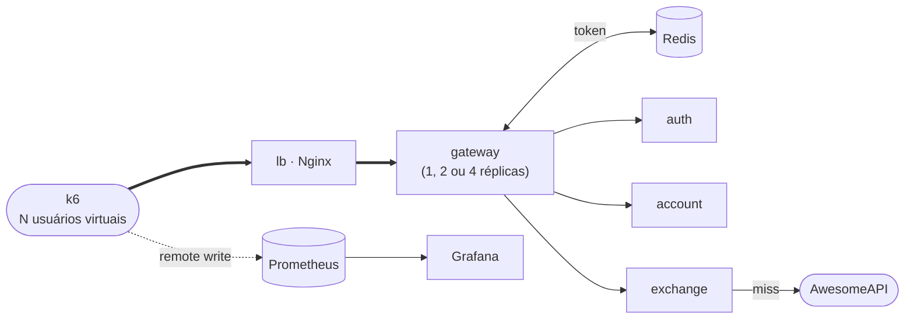
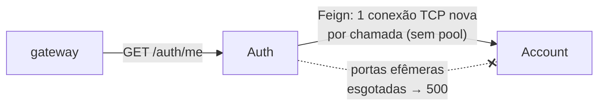
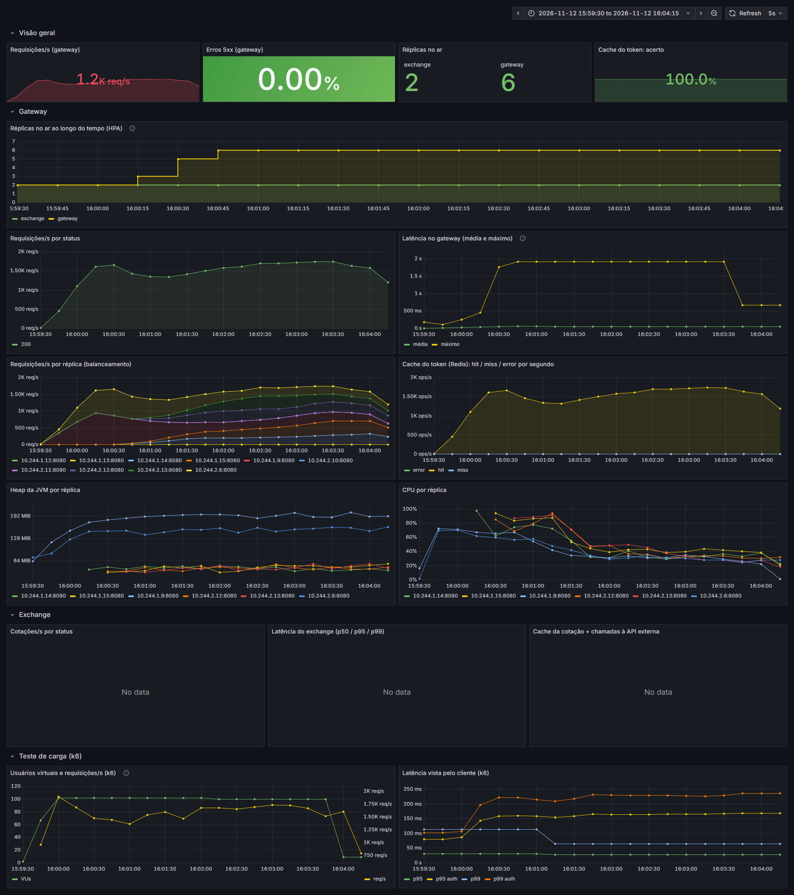
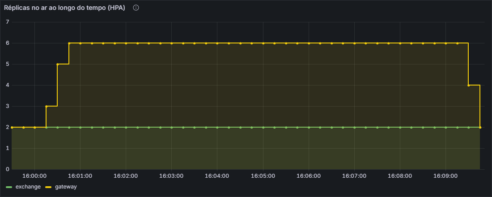
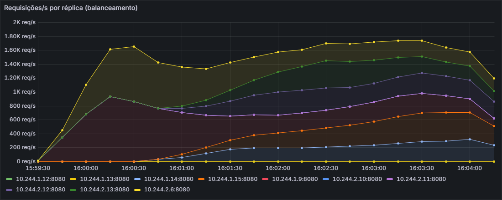
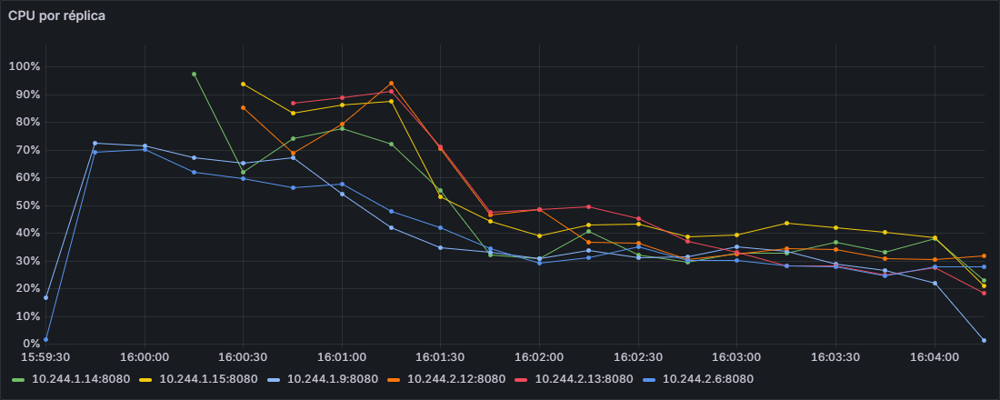

# Testes de carga

!!! info "Responsável: Gabriel"

Ferramenta: **[k6](https://k6.io){target="_blank"}** (Grafana Labs), rodando em container — ninguém do
grupo precisa instalar nada além do Docker. Escolhemos o k6 em vez do JMeter/Locust porque o teste é
um arquivo JavaScript versionado no repositório, os limites de aceitação (*thresholds*) ficam no
próprio script e ele envia as métricas direto para o Prometheus, então a carga aparece no mesmo
[dashboard do Grafana](../bottlenecks/observability.md) que as métricas do servidor.

## O que é testado



O `setup()` do script cria 20 contas e faz login uma vez; depois os usuários virtuais (VUs) reaproveitam
os tokens, como usuários reais navegando logados. Cada VU espera 0,5–1,5 s entre as ações.

| Cenário | Requisições | O que exercita |
|---|---|---|
| `auth` | `GET /auth/me` + `GET /accounts/{id}` | validação do token (Redis ou Auth), balanceamento, Account + PostgreSQL |
| `exchange` | `GET /exchange/USD/BRL` (80 %) e `EUR/BRL` | gateway → Exchange → cache da cotação / API externa |
| `login` | `POST /auth/login` | caminho caro: hash da senha + emissão do JWT |
| `mixed` | 80 % leitura autenticada, 15 % câmbio, 5 % login | uso "real" da loja |

| Perfil | Forma da carga | Pergunta que responde |
|---|---|---|
| `smoke` | 1 VU, 20 s | O script e a plataforma funcionam? |
| `load` | sobe em 20 s até `VUS`, mantém por `DURATION`, desce | Aguenta a carga esperada dentro do SLO? |
| `stress` | `VUS` → ×2 → ×4 → ×8, 30 s cada | Onde quebra? Qual componente satura primeiro? |
| `spike` | `VUS/10` → pico de `VUS×4` em 5 s → volta | Aguenta um pico repentino e se recupera? |

**Critérios de aceitação** (os mesmos do [SLO](custos-sla.md#sla-e-slo)), checados pelo k6 — ele sai
com código `99` se algum estourar:

| Métrica | Limite |
|---|---|
| Erros (`http_req_failed`) | < 1 % |
| Latência p95 / p99 (respostas esperadas) | < 500 ms / < 1500 ms |
| `checks` (status e conteúdo das respostas) | > 99 % |

## Como rodar

``` bash
./scripts/build.sh && docker compose up -d --build     # plataforma + Prometheus + Grafana

./scripts/load-test.sh                                  # mixed, perfil load, 50 VUs, 1 min
SCENARIO=auth PROFILE=stress VUS=50 ./scripts/load-test.sh
SCENARIO=exchange PROFILE=spike VUS=20 ./scripts/load-test.sh
THINK=0 SCENARIO=auth PROFILE=stress VUS=25 ./scripts/load-test.sh   # sem pausa: limite de vazão
BASE_URL=http://<endereço-do-elb> ./scripts/load-test.sh   # contra o EKS

./scripts/load-matrix.sh        # todos os experimentos abaixo (~25 min) -> load/results/RESULTS.md
```

Enquanto roda, abra o Grafana em [http://localhost:3000](http://localhost:3000){target="_blank"}: a
linha **Teste de carga (k6)** mostra VUs, req/s e p95/p99 do cliente, e as linhas de cima mostram o
que acontece em cada réplica, no Redis e no Exchange no mesmo instante.

## Experimentos

O `scripts/load-matrix.sh` muda **uma** variável por vez e mantém o resto igual (cache do Redis
esvaziado antes de cada rodada):

| # | Experimento | Variável | Cenário / perfil | Hipótese |
|---|---|---|---|---|
| 1 | Cache do token | `TOKEN_CACHE_ENABLED` = `false` × `true` | `auth` / `load` | Sem cache, cada requisição chama o Auth: mais carga no Auth e latência maior quando ele satura. Com cache, `gateway_token_cache_total{result="miss"}` fica perto de 20 (um por usuário). |
| 2 | Réplicas do gateway | `GATEWAY_REPLICAS` = 1 × 2 × 4 | `auth` / `stress` | Mais réplicas atrasam o ponto em que o p95 estoura — **até** o gargalo passar para outro componente (Account/PostgreSQL ou a própria CPU da máquina). |
| 3 | Cache da cotação | `EXCHANGE_CACHE_TTL` = `0` × `30` | `exchange` / `load`, 10 VUs, 30 s | Sem cache, a latência do Exchange é a da API externa e aparecem `429`; com cache, ~1 chamada externa a cada 30 s por réplica. Poucos VUs de propósito: não queremos martelar um serviço de terceiros. |
| 4 | Uso real | configuração padrão | `mixed` / `load` | Dentro do SLO. |
| 5 | Saturação | `GATEWAY_REPLICAS` = 1 × 4, **`THINK=0`** (sem pausa) | `auth` / `stress` até 200 VUs | Com pausa, o experimento 2 não chega ao limite; sem pausa, cada VU dispara o mais rápido possível e mostra o que quebra primeiro. |

## Resultados

Medidos em **05/11/2026** com `./scripts/load-matrix.sh` (os experimentos 3 e 5 foram rodados de novo
com `ONLY="3 5"`). Máquina: Windows 11 + Docker Desktop (WSL2), 12 CPUs lógicas, 7,3 GiB de RAM para
o Docker. **k6, Nginx, gateway, serviços, banco, Prometheus e Grafana na mesma máquina.** Latências
só das respostas esperadas e só da fase de teste (o cadastro/login do `setup()` fica de fora).

| Execução | Cenário | Perfil | VUs máx. | Requisições | req/s | p50 (ms) | p95 (ms) | p99 (ms) | Erros |
|---|---|---|---:|---:|---:|---:|---:|---:|---:|
| token-cache-off | auth | load | 50 | 7.416 | 80,8 | 5 | 12 | 20 | 0,00 % |
| token-cache-on | auth | load | 50 | 7.448 | 79,7 | 4 | **7** | 15 | 0,00 % |
| replicas-1 | auth | stress | 400 | 41.110 | 290,9 | 2 | 3 | 4 | 0,00 % |
| replicas-2 | auth | stress | 400 | 40.810 | 287,1 | 2 | 17 | 114 | 0,00 % |
| replicas-4 | auth | stress | 400 | 40.918 | 285,8 | 3 | 7 | 23 | 0,00 % |
| exchange-cache-off | exchange | load | 10 | 445 | 7,3 | 23 | 49 | 69 | 0,00 % |
| exchange-cache-on | exchange | load | 10 | 454 | 7,5 | 3 | **4** | 17 | 0,00 % |
| mixed-load | mixed | load | 50 | 6.605 | 72,1 | 4 | 62 | 197 | 0,00 % |
| saturation-1 | auth | stress, `THINK=0` | 200 | 578.564 | **4.120** | 13 | 43 | 69 | **0,57 %** |
| saturation-4 | auth | stress, `THINK=0` | 200 | 387.296 | 2.697 | 14 | 88 | 166 | **0,00 %** |

**Todos os cenários com pausa (1–4) ficaram dentro do SLO** (erros < 1 %, p95 < 500 ms, p99 < 1,5 s).

### O que os números mostram

**1. Cache do token (Redis) — o Auth sai do caminho.** Com o cache ligado, o Prometheus registrou
**7.571 hits e 21 misses** em `gateway_token_cache_total` durante a rodada: 99,7 % das validações não
chamaram o Auth (os 21 misses são ≈ 1 por usuário do teste). Sem cache, todas as ≈ 7.400 requisições
passaram pelo `POST /auth/solve`. A latência caiu de p95 12 → **7 ms** (−42 %). A vazão é a mesma nas
duas rodadas porque quem dita o ritmo é a pausa dos usuários, não o servidor.

**2. Cache da cotação — a API externa sai do caminho.** Sem cache, toda cotação ia até a AwesomeAPI:
p50 de 23 ms e p95 de 49 ms, a latência de um serviço de terceiros. Com o cache de 30 s, p50 de **3 ms** e
p95 de **4 ms** (−92 %). Em 10 usuários a API externa aguentou sem `429`, mas o volume de chamadas a ela
cai de ≈ 7 por segundo para 1 a cada 30 s por réplica — é isso que protege do limite de requisições.

**3. Réplicas com carga "realista" — um gateway sobra.** Com a pausa entre ações, 400 usuários geram
≈ 290 req/s, e uma réplica só responde com p95 de 3 ms. As diferenças entre 1, 2 e 4 réplicas
(3 / 17 / 7 ms) são ruído de JVMs recém-criadas (ainda sem o JIT aquecido), não ganho nem perda.
Conclusão honesta: **nessa carga o gateway não é o gargalo**; o motivo para ter 2+ réplicas é
disponibilidade (uma pode cair), não capacidade.

**4. Saturação — achamos o gargalo real, e não era o gateway.** Sem pausa, a plataforma passou de
**4.100 req/s** com uma réplica do gateway, mas **0,57 % das requisições falharam (3.279)**, todas em
`GET /auth/me`, nenhuma em `GET /accounts/{id}`. O gateway devolveu `500` e o log do Auth mostrou
exatamente **3.279 × `java.net.BindException: Cannot assign requested address`**:



O `GET /auth/me` do Auth chama o Account pelo **OpenFeign com o cliente HTTP padrão, sem pool de
conexões**: cada requisição abre uma conexão TCP nova, e a 4.000 req/s as portas locais do container do
Auth acabam (as fechadas ficam em `TIME_WAIT`). Com 4 réplicas do gateway a máquina ficou mais
ocupada (CPU em ≈ 83 % nas duas rodadas, 4 JVMs disputando os mesmos núcleos), a vazão caiu para
2.697 req/s e o Auth não chegou no limite — por isso 0 erros, mas p95 o dobro.

!!! tip "Correção sugerida (Auth — Nicolas)"

    Trocar o cliente do Feign por um com **pool de conexões** e keep-alive — adicionar
    `io.github.openfeign:feign-hc5` ao `auth-service` e `spring.cloud.openfeign.httpclient.hc5.enabled=true`.
    Com conexões reaproveitadas, o Auth deixa de abrir uma porta por requisição. Depois, repetir
    `ONLY=5 ./scripts/load-matrix.sh` para confirmar que os `500` somem.

**5. Uso real (`mixed`).** Dentro do SLO, mas com a cauda mais longa da bateria (p95 62 ms, p99 197 ms):
5 % das ações são `POST /auth/login`, que faz o hash da senha (custoso de propósito) e emite o JWT.

### Limitações

- **Tudo na mesma máquina:** o k6 disputa CPU com a plataforma. Os números mostram **tendências e
  gargalos**, não a capacidade do EKS. Em nós separados, mais réplicas devem *aumentar* a vazão —
  aqui ficaram presas à mesma CPU.
- **Rodadas curtas (1–3 min) e uma execução por configuração:** diferenças de poucos ms são ruído.
- **20 contas reutilizadas:** favorece o cache do token (é o padrão de uso logado, mas um teste com
  milhares de usuários novos teria mais misses).

Para medir a capacidade real: `BASE_URL=http://<elb> ./scripts/load-test.sh` a partir de outra máquina.

## Teste no EKS com HPA

O curso pede um **vídeo do teste de carga em execução com o HPA escalando**. Roteiro para o dia do EKS:
k6 rodando da máquina de um integrante contra o ELB, e o **Horizontal Pod Autoscaler** criando réplicas
do gateway quando a CPU média passa de 50 % do `request` (250m → 125m por pod).

!!! warning "Antes de começar"

    - **metrics-server** instalado no cluster (o EKS não traz, e o `eks-store.yaml` não instala; sem ele o
      HPA fica em `<unknown>`). Instalar e conferir:
      `kubectl apply -f https://github.com/kubernetes-sigs/metrics-server/releases/latest/download/components.yaml`
      e, depois de ≈ 1 min, `kubectl top nodes`.
    - **Cenário `auth`, não `exchange` nem `mixed`:** a AwesomeAPI devolveu `429` para o IP da AWS, então
      o Exchange responde `503` no EKS (o `mixed` tem 15 % de câmbio: sairiam ≈ 15 % de erro).
    - **Ninguém faz push na `main` durante a gravação:** o deploy do CI faz `kubectl apply` do manifesto
      do gateway (`replicas: 2`) e briga com o HPA.
    - **Capacidade:** os 2 nós fixos têm espaço para **mais ≈ 6 réplicas do gateway** (conta em
      [Custos](custos-sla.md#o-que-precisa-rodar)), 8 no total. Com `--max=10`, as réplicas 9 e 10 ficariam
      *Pending*. O roteiro usa `--max=6` para ter folga: a sobra está dividida entre os 2 nós (≈ 0,8 vCPU
      em cada) e um pod não usa pedaços de nós diferentes, então a 7ª e a 8ª podem não caber. Se o grupo
      preferir mostrar o limite, `--max=10` e os *Pending* viram parte do resultado.
    - **Mais de uma tomada:** antes de repetir o teste, `kubectl rollout restart deployment/auth
      deployment/account -n store`. No ensaio, o Auth foi morto por falta de memória na segunda rodada
      pesada seguida ([achado](#achado-oom-auth)).

**Três terminais lado a lado** (no Windows não existe `watch`; o `-w` do `kubectl` faz o mesmo):

=== "1 · HPA"

    ``` bash
    kubectl autoscale deployment gateway --cpu=50% --min=2 --max=6 -n store
    kubectl get hpa gateway -n store -w
    # --cpu-percent=50 é a forma antiga: o kubectl 1.36 ainda aceita, mas avisa que foi descontinuada
    ```

=== "2 · Pods do gateway"

    ``` bash
    kubectl get pods -n store -l app=gateway -o wide -w
    ```

=== "3 · k6"

    ``` bash
    ELB=$(kubectl get svc lb -n store -o jsonpath='{.status.loadBalancer.ingress[0].hostname}')
    # (opcional) métricas do k6 no Grafana do cluster: noutro terminal,
    #   kubectl port-forward svc/prometheus 9090 -n store
    #   (no Linux, com --address 0.0.0.0: senão o container do k6 não alcança o port-forward)
    BASE_URL=http://$ELB PROMETHEUS_RW_URL=http://host.docker.internal:9090 \
      NAME=eks-hpa SCENARIO=auth PROFILE=load VUS=100 DURATION=4m THINK=0 ./scripts/load-test.sh
    ```

`--min=2` porque o manifesto do gateway já sobe 2 réplicas: com `--min=1` o HPA derrubaria uma logo no
começo do vídeo. O HPA olha a CPU a cada 15 s e o metrics-server tem até ≈ 1 min de atraso, por isso o
platô tem 4 min. Depois do teste, o HPA espera **5 min** sem carga antes de reduzir as réplicas: dá
para continuar gravando e mostrar a volta para 2.

**Print do Grafana durante o teste** (página de [Observabilidade](../bottlenecks/observability.md)):
`kubectl port-forward svc/grafana 3000 -n store`, dashboard *Store — plataforma*. O painel
"Réplicas no ar ao longo do tempo (HPA)" mostra a subida e a volta para 2; "Requisições/s por réplica"
e "CPU por réplica" mostram as réplicas novas entrando e dividindo a carga.

**Gravar sem depender de janela:** o `scripts/hpa-record.py` ([código](#codigo)) roda os três
terminais acima, grava o vídeo e tira os prints do Grafana sozinho (detalhes no
[ensaio local](#ensaio-local-kind)):

``` bash
pip install playwright imageio-ffmpeg pillow    # uma vez; usa o Edge instalado
python scripts/hpa-record.py --base-url http://$ELB --name eks-hpa --label "EKS (eks-store)"
```

**O que esperar** (visto no [ensaio local](#ensaio-local-kind)): as réplicas novas levam ≈ 1,5 min para
receber a parte delas da carga ([por quê](#achado-balanceamento)), e na redução os pods removidos
aparecem como `Error` no terminal 2. Esse `Error` é o código de saída **143** (128 + SIGTERM) que a JVM
devolve quando o Kubernetes manda o pod parar, conferido no `state.terminated.exitCode` do pod: não é falha.

**Depois:** apagar o HPA (`kubectl delete hpa gateway -n store`) antes de apagar o cluster.

### Ensaio local (kind)

O roteiro acima foi ensaiado em 12/11/2026, antes do dia do EKS, num cluster **kind** (Kubernetes
dentro do Docker) montado para ficar parecido com o `eks-store` e com **os mesmos manifestos**:

| | `eks-store` (EKS) | Ensaio local (kind) |
|---|---|---|
| Kubernetes | 1.37 | 1.37 |
| Nós | 2 × `t3.medium` | 2 workers com o alocável de um `t3.medium` (1930m de CPU, 3,4 GiB) |
| Manifestos | `k8s/` e o `k8s/` de cada serviço | os mesmos; muda só a imagem (a do `docker compose build`) |
| Banco | RDS | Postgres dentro do cluster |
| Entrada | ELB → `lb` | `localhost:8081` → NodePort do `lb` |
| HPA | metrics-server | metrics-server |

A conta de capacidade de [Custos](custos-sla.md#o-que-precisa-rodar) se confirmou: com a plataforma no
ar, cada nó tinha **1050m de CPU reservados de 1930m**, ou seja, cabem mais 3 gateways por nó (+6 no
total). O ensaio **não** reproduz a latência do EKS (os nós do kind dividem os 12 núcleos da máquina,
então um nó pode passar de 2 vCPU) nem o caminho pela internet e pelo ELB.

``` bash
docker compose build              # imagens dos serviços
./scripts/kind-up.sh              # cluster + plataforma (≈ 4 min)
python scripts/hpa-record.py      # HPA + k6 + vídeo + prints do Grafana (≈ 11 min)
kind delete cluster --name store
```

O `hpa-record.py` roda os três comandos do roteiro e mostra as saídas lado a lado numa página local,
que um Edge sem janela fotografa 2 vezes por segundo: o vídeo não depende de janela aberta e não mostra
nada da tela de quem roda. Depois do k6, continua gravando até o HPA voltar a 2 réplicas e salva em
`load/results/<nome>/` o vídeo (tempo real e 8×), a linha do tempo das réplicas, um resumo e os prints
do Grafana com o intervalo exato do teste.

#### Resultado do ensaio

| Execução | VUs | Requisições | req/s | p50 (ms) | p95 (ms) | p99 (ms) | Erros | Réplicas (início → máx.) |
|---|---:|---:|---:|---:|---:|---:|---:|---|
| kind-hpa | 100 | 435.094 | 1.606,5 | 48 | 148 | 196 | 0,00 % | 2 → 6 |

| Tempo desde o início do k6 | O que aconteceu |
|---|---|
| 0 → 20 s | o k6 sobe de 0 para 100 VUs (cenário `auth`, sem pausa entre as requisições) |
| +27 s | CPU média do gateway em 131 % do `request` (alvo: 50 %): o HPA pede **4** réplicas |
| +40 s | 4 réplicas no ar e CPU em 206 %: o HPA pede **6**, o máximo |
| +64 s | as 6 réplicas prontas; nenhuma ficou sem espaço nos nós (*Pending*) |
| +75 s → +150 s | as réplicas novas passam a receber carga, aos poucos ([achado](#achado-balanceamento)) |
| +4 min 33 s | o k6 termina: **0 erros** em 435.094 requisições |
| +10 min | o HPA volta para **2** réplicas, ≈ 5,5 min depois do fim da carga (a espera padrão é de 5 min) |

<video controls preload="metadata" width="100%" src="../hpa/kind-hpa-8x.mp4"></video>

Vídeo **8× mais rápido** (1 min 20 s para 10 min 36 s de teste); o relógio no canto superior direito
mostra o tempo real. Terminal 1: o HPA (CPU média × alvo e réplicas); terminal 2: os pods do gateway
nascendo (*Pending* → *ContainerCreating* → *Running*) e, no fim, saindo; terminal 3: o k6. A versão em
tempo real fica em `load/results/kind-hpa/hpa-tempo-real.mp4` (17 MB, fora do git).

Grafana do cluster durante o teste (do início do k6 ao fim da carga):





A linha *exchange* do dashboard fica vazia porque o cenário `auth` não chama o câmbio.

#### Achado: as réplicas novas demoram ≈ 1,5 min para receber carga { #achado-balanceamento }

O painel **Requisições/s por réplica** (as faixas empilhadas, uma por réplica) mostrou o que o k6
sozinho não mostra: as 4 réplicas que o HPA criou ficaram prontas em +64 s, mas **receberam 0 req/s**
até ≈ +75 s e só dividiram a carga por igual em ≈ +150 s.



| Tempo desde o início do k6 | 2 réplicas antigas (req/s cada) | 4 réplicas novas (req/s cada) |
|---|---|---|
| +60 s | ≈ 740 | 0 |
| +90 s | ≈ 520 | 60 – 100 |
| +120 s | ≈ 360 | 175 – 340 |
| +150 s | ≈ 255 | 210 – 380 |

A CPU mostra o outro lado: as 4 réplicas novas começam em 85–97 % de 1 CPU **quase sem receber
requisições** (é a JVM aquecendo: carga de classes e compilação), enquanto as 2 antigas seguram a
carga em ≈ 60–70 %. Só por volta de +140 s todas ficam em ≈ 30–40 %.



**Por quê:** o `lb` (Nginx) fala com o Service `gateway`, que é um IP virtual, e **reaproveita as
conexões** (`keepalive 32` no `upstream`). O Service balanceia **conexões, não requisições**: cada
conexão nova é sorteada entre os pods, mas uma conexão aberta fica no pod em que nasceu. As réplicas
novas só recebem conexões novas e, com a carga estável, o Nginx só abre uma conexão nova quando fecha
uma antiga, o que por padrão acontece depois de **1000 requisições** na mesma conexão
(`keepalive_requests`). Com ≈ 100 requisições em paralelo e ≈ 1.600 req/s, cada conexão faz ≈ 16 req/s
e leva ≈ 1 min para chegar a 1000. No compose não acontece porque lá o Nginx enxerga cada réplica pelo DNS do Docker e
divide as requisições ele mesmo.

**Correções possíveis (`k8s/lb.yaml`, Leonardo):**

1. **Uma linha** no `upstream gateways`: `keepalive_time 10s;` (Nginx ≥ 1.21.3). Cada conexão dura no
   máximo 10 s, então as réplicas novas entram na divisão bem mais cedo. Testado no ensaio, em duas
   rodadas de 3 min: a carga ficou dividida por igual **≈ 35–40 s** depois de as réplicas novas ficarem
   prontas, contra ≈ 86 s sem a linha, e a rodada com Auth e Account recém-reiniciados terminou com
   **0 erros**. A vazão dessas rodadas não serve de comparação (numa o Auth caiu, como no achado
   abaixo; na outra Auth e Account tinham acabado de reiniciar).
2. **Igual ao compose:** um Service *headless* (`clusterIP: None`) para o gateway e, no Nginx,
   `server <service-headless>:8080 resolve;` com `resolver kube-dns.kube-system.svc.cluster.local valid=10s;`.
   O Nginx passa a enxergar cada pod e divide as requisições ele mesmo, como no compose.

#### Achado: o Auth foi morto por falta de memória na rodada seguinte { #achado-oom-auth }

Na rodada de comparação acima (a segunda rodada pesada seguida), o Auth foi **OOMKilled** (código
137) aos +3 min: nos ≈ 30–40 s seguintes, enquanto ele reiniciava, o gateway recebeu
`connection refused` e `connect timeout` do Auth e devolveu **500** em **0,52 %** das requisições
(1.413 falhas, todas em `GET /auth/me`).

A causa está no Dockerfile dos quatro serviços Java: `-XX:MaxRAMPercentage=75`. Com o limite de 512 Mi
do Auth, o heap pode chegar a 384 Mi e sobram só 128 Mi para o resto da JVM (metaspace, threads,
código compilado), pouco para um Spring Boot sob carga. A primeira rodada fez o heap crescer e a
segunda passou do limite. O Account, com a mesma configuração, estava em 393 Mi de 512 Mi.

- **No dia do EKS:** entre uma tomada e outra do vídeo, reiniciar o Auth e o Account
  (`kubectl rollout restart deployment/auth deployment/account -n store`).
- **Correção sugerida (Nicolas):** `-XX:MaxRAMPercentage=60` (heap até ≈ 307 Mi, ≈ 205 Mi para o resto)
  ou limite de 768 Mi no `k8s.yaml` do Auth e do Account. O `request`, que é o que o scheduler reserva,
  não muda, então a conta de capacidade de [Custos](custos-sla.md#o-que-precisa-rodar) continua valendo.

### Resultado no EKS

!!! warning "A medir no dia do EKS"

    Preencher com o resumo do k6 (`load/results/eks-hpa.row.md`), o número máximo de réplicas que o HPA
    criou, quanto tempo levou para escalar, e o link do vídeo. **Não preencher com números estimados.**

| Execução | VUs | Requisições | req/s | p50 (ms) | p95 (ms) | p99 (ms) | Erros | Réplicas (início → máx.) |
|---|---:|---:|---:|---:|---:|---:|---:|---|
| eks-hpa | | | | | | | | 2 → |

<!-- vídeo do HPA: <iframe width="100%" height="470" src="https://www.youtube.com/embed/<id>" allowfullscreen></iframe> -->

## Código

=== "load/store.js"

    ``` { .js .copy linenums="1" }
    --8<-- "load/store.js"
    ```

=== "scripts/load-test.sh"

    ``` { .bash .copy }
    --8<-- "scripts/load-test.sh"
    ```

=== "scripts/load-matrix.sh"

    ``` { .bash .copy }
    --8<-- "scripts/load-matrix.sh"
    ```

=== "scripts/kind-up.sh"

    ``` { .bash .copy }
    --8<-- "scripts/kind-up.sh"
    ```

=== "scripts/hpa-record.py"

    ``` { .python .copy }
    --8<-- "scripts/hpa-record.py"
    ```
